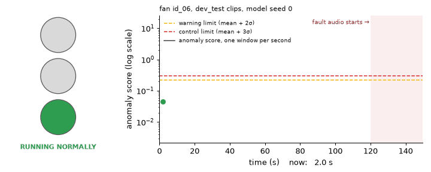
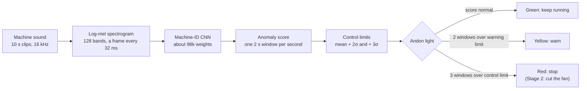
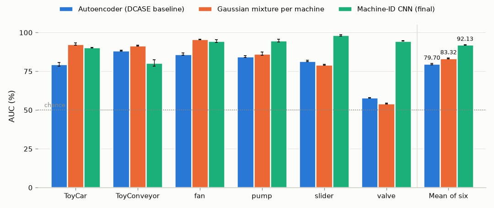

# Andon

[](https://github.com/abtinmbm/andon/actions/workflows/ci.yml)
[](LICENSE)

**An andon light that listens.** Andon learns what a healthy machine sounds like from recordings of normal running only, then turns a green / yellow / red light when the machine starts to sound wrong. It never needs a recording of a fault to train.



*Replay of one fan (machine `id_06`, development test clips, model seed 0, at 8x real time): about two minutes of normal running, then a fault. The yellow light partway through is a real warning that clears by itself without stopping the line. This machine was picked to show how the light works; typical rates are in the tables below.*

## At a glance

| | Result (evaluation set, scored once, mean ± std over 3 seeds) |
| --- | --- |
| **Detects faulty sound** | **92.13 ± 0.16 %** AUC over six machine types, against 79.70 ± 0.39 % for the DCASE 2020 autoencoder baseline |
| **Runs as a live andon light** | catches 65.57 ± 1.02 % of faults, turns red 10.57 ± 0.24 s after a fault starts, 5.53 ± 1.79 false alarms per hour |
| **Fits a microcontroller** | 98.7 KB as an int8 model, AUC change −0.04 ± 0.02 points; measured on the Pico 2, 10.82 ms of compute per 32 ms of audio, bit-exact with Python |
| **Reproducible** | two commands re-download the data and checkpoints and re-score the headline [to four decimals](#reproduce-the-headline-number) |

**Stage 1** (done) builds and evaluates the detector on the public [DCASE 2020 Task 2](https://dcase.community/challenge2020/task-unsupervised-detection-of-anomalous-sounds) factory-sound benchmark and plays it back as a live andon light. **Stage 2** (in progress) runs the same pipeline on a Raspberry Pi Pico 2 that cuts power to a real fan when it hears a fault, the lean-manufacturing idea of *jidoka*: stop the line the moment something is wrong. Full plan: [PLAN.md](PLAN.md).

## How it works



1. **Features.** Each clip becomes a log-mel spectrogram: how loud each of 128 frequency bands is, every 32 ms.
2. **Model.** One small CNN per machine type learns to tell that type's individual machines apart (fan `id_00` from fan `id_02`, and so on), from normal recordings only. Training blends pairs of examples (mixup) so the classifier doesn't become overconfident.
3. **Score.** If the CNN can no longer recognise which machine it is hearing, something has changed. The score of a 2 s window is `-log p(correct machine ID)`; a faulty machine sounds unlike its normal self, so its own ID becomes less likely.
4. **Limits, set like an SPC control chart.** For each machine, half of its normal test clips set a warning limit (mean + 2σ of the window scores) and a control limit (mean + 3σ). The other half is the normal running the light is judged on.
5. **The light.** Yellow comes on after 2 windows in a row above the warning limit and goes off after 3 in a row below it, so a score hovering at the limit doesn't flicker. Red needs 3 windows in a row above the control limit and stays on until someone presses reset.

## Results

### Telling faulty sound from normal



AUC is the chance that a randomly picked faulty clip scores as more abnormal than a randomly picked normal one: 50 % is guessing, 100 % is perfect.

| Evaluation AUC (%) | Autoencoder (DCASE baseline) | Gaussian mixture per machine | **Machine-ID CNN (final)** |
| --- | ---: | ---: | ---: |
| ToyCar | 79.65 ± 1.17 | 92.63 ± 0.80 | 90.29 ± 0.27 |
| ToyConveyor | 88.31 ± 0.38 | 91.64 ± 0.19 | 80.38 ± 2.00 |
| fan | 86.10 ± 0.82 | 95.58 ± 0.22 | 94.47 ± 0.86 |
| pump | 84.51 ± 0.57 | 86.46 ± 0.95 | 94.73 ± 0.85 |
| slider | 81.73 ± 0.41 | 79.34 ± 0.24 | 98.25 ± 0.40 |
| valve | 57.93 ± 0.19 | 54.27 ± 0.26 | 94.64 ± 0.23 |
| **Mean of six types** | 79.70 ± 0.39 | 83.32 ± 0.27 | **92.13 ± 0.16** |

Evaluation set, scored once per model. Mean ± sample std over seeds 0, 1, 2; configs `phase3_baseline_eval`, `phase2_gmm_id` and `phase3_idcnn_mixup`. The chart is drawn from the same log by `andon.chart`. Full dev and eval tables, with pAUC: [results/phase3_comparison.md](results/phase3_comparison.md).

The CNN beats the autoencoder baseline on 5 of the 6 machine types and loses on ToyConveyor. A much simpler model, a Gaussian mixture on each clip's average spectrum, still beats it on ToyCar, ToyConveyor and fan; the CNN's lead comes from valve, slider and pump, where a 2 s window catches what an average spectrum smooths away.

<details>
<summary>Development set results (used for every choice)</summary>

The PyTorch reproduction of the DCASE 2020 autoencoder baseline scores 73.80 ± 0.14 mean dev AUC, against the published 73.51. The per-machine Gaussian mixture scores 83.25 ± 0.22, the plain machine-ID CNN 84.33 ± 0.67 and the final CNN with mixup 86.64 ± 0.57. Tables: [results/phase2_comparison.md](results/phase2_comparison.md), [results/phase3_comparison.md](results/phase3_comparison.md).

</details>

### The andon light on a continuous stream

The simulator streams test audio through the model window by window: 20 s of normal running, then a fault of 3 anomalous clips of the same machine (about 30 s).

| Config `phase5_andon`, mean of six types | Development test | Evaluation (scored once) |
| --- | --- | --- |
| False alarms per hour of normal audio | 4.49 ± 0.56 | 5.53 ± 1.79 |
| Faults caught before they end | 52.96 ± 0.99 % | 65.57 ± 1.02 % |
| Time from fault start to red, faults caught | 12.02 ± 0.32 s | 10.57 ± 0.24 s |

Mean ± std over model seeds 0, 1, 2. Per-type tables: [results/phase5_simulator.md](results/phase5_simulator.md). The limits of the model and of these numbers are in the [model card](docs/model_card.md).

### Small enough for a microcontroller

The Stage 2 budget is at most 256 KB of model and under 20 ms of compute for every 32 ms of audio. Stored as 8-bit integers (int8), the same trained CNN fits in memory with room to spare and scores almost the same:

| Machine-ID CNN | Float32 (PC) | Int8 (microcontroller) |
| --- | ---: | ---: |
| Model size | 383.0 KB | 98.7 KB |
| Estimated compute per 32 ms of audio | | 3.27 ms |
| Development AUC, mean of six types (%) | 86.64 ± 0.57 | 86.64 ± 0.60 |
| Evaluation AUC, mean of six types (%), scored once | 92.13 ± 0.16 | 92.08 ± 0.17 |

Configs `phase3_idcnn_mixup` and `phase4_idcnn_int8`, seeds 0, 1, 2. All three models, before and after int8: [results/phase4_mcu.md](results/phase4_mcu.md).

The compute figure is an estimate. Measured on the Pico 2, the C port gives the same int8 inputs and scores as Python, and one CNN score takes 299.68 ms against the estimated 98.32 ms, so the total is 10.82 ms per 32 ms frame on one core: under the 20 ms budget ([results/h5_bench_pico2.md](results/h5_bench_pico2.md)). The first C kernel was about three times slower and over budget; rewriting the convolution's inner loop brought it under (DECISIONS.md, 2026-11-10).

<details>
<summary>How the int8 model was made and checked</summary>

The int8 model is the trained float model converted without retraining, by a NumPy reference implementation (`andon/quant.py`). On eval it changes AUC by −0.04 ± 0.02 points: a small, consistent drop, smaller than the spread between seeds. Compute is estimated from the count of multiply-adds at 0.5 per clock cycle on the Pico 2's 150 MHz Cortex-M33; a full window score takes 98.32 ms and runs once a second, which is where the per-frame average comes from. The board's measurement is above.

`andon.export_c` writes the int8 model as C headers, with test vectors the C version must match bit for bit up to the last layer's integer sums (the float logits and scores within a small tolerance). CI runs the export on every push with a seeded synthetic model of the same shape.

</details>

### Cutting the fan (Stage 2, H1)

The Pico 2 switches a 5 V fan through a logic-level MOSFET (IRLZ44N, with a 1N4007 flyback diode); its pin only ever drives the MOSFET's gate. A serial `fan off` or a red andon light cuts the fan's power, and on red only the reset button restarts it. Measured on the board with `andon.fan_latency`, every log naming the firmware build it ran:

| Test | `fan off` trials | Gate drive (GP16) low after the command, median / max | PC round trip, median / max |
| --- | ---: | ---: | ---: |
| Full speed ([table](results/h1_fan_latency.md)) | 20 | 29 / 41 µs | 2.01 / 2.76 ms |
| 50 %, after the kick-start ([table](results/h1_fan_latency_50.md)) | 10 | 6 / 16 µs | 2.00 / 2.61 ms |
| 50 %, during the kick-start ([table](results/h1_fan_latency_kick.md)) | 10 | 20 / 39 µs | 2.46 / 3.35 ms |

The target was under 100 ms. Every trial passed, and each `fan off` followed a start that had powered the fan. The round trip runs from the PC writing the command to the Pico's reply arriving, so it includes USB both ways. Pressing the button to red cut the fan within the same millisecond, `fan on` was refused while red, and the reset restarted it ([raw log](results/h1_andon_red.txt)). "Off" means the fan has no power. The blades then coast to a stop over a few seconds. The fan is also off at boot, so a reset or a power blip never restarts the machine by itself.

### Listening to real fans (Stage 2, H3)

Three real 5 V fans (`id_00`, a Sunon; `id_01` and `id_02`, two identical ANVISION fans) were recorded through the board's microphone in three sessions on different days, in one room: two for development (`d1`, `d2`) and one held out (`d3`). Each session has, per fan, 30 min of normal running, a 3 min "control" take of normal running after the fan was taken off its mount and put back, and 3 min of each fault: **underspeed** (the drive switched on 85 % of the time) and **obstruction** (a card strip over part of the intake). The models train on normal audio from the other sessions only. The light's limits are set on the first 10 min of the tested session's normal running, the way the device will calibrate itself, and it is judged on the rest.

| Held-out session `d3`, scored once | Gaussian mixture per fan (chosen on dev) | Sound level only (reference) |
| --- | ---: | ---: |
| AUC, every one of the 3 fans x 2 faults | 100.00 ± 0.00 | 100.00 |
| False reds per hour, normal running | 0.00 ± 0.00 | 0.00 |
| False reds per hour, after a remount without recalibrating | 15.53 ± 3.84 | 0.00 |
| Fault takes that turned the light red | 6 of 6 | 6 of 6 |
| Seconds to red, from the first fault clip played after normal running | 4.10 ± 0.00 | 4.10 |

**A plain sound-level meter catches these two faults as well as the model does.** Underspeed makes a fan quieter and the card makes it louder, both by much more than anything in normal running, so on `d3` the meter scores as well as the model, and after a remount it raises fewer false reds. That is reported as it came out. The dev check below shows the model also hears the shape of the sound, not only its loudness. 4.10 s is the light's own fastest red (three windows in a row over the limit), so the time to red measures the light's settings, not the model. It is timed from a splice of normal and fault recordings, not from a real fault starting: the first 30 s of underspeed (the fan still slowing) are not used, and the card is fitted with the fan off. The real switch-to-stop time is measured on the board below. Normal running in `d3` is about an hour over the three fans, so a single false red would read as about one per hour.

**Is the model only a loudness meter? (dev only.)** Two checks, neither touching `d3`:

- *Same volume.* Every test window is shifted to the fan's normal level before scoring, as if played back at the fan's normal volume. The features are in dB, so this removes the volume exactly and leaves only the shape of the spectrum, and the level meter can no longer tell anything apart. The same mixture, trained as before, still scores 100.00 ± 0.00 on every fan-and-fault cell of both dev folds (`h3_gmm_levelmatched`, seeds 0-2). So the faults can be heard without their loudness, and the model hears them that way. This does not show it would catch a fault that is quiet in real life; that is the next test (H7).
- *The benchmark.* The same kind of meter, one per machine ID, on the DCASE dev set (`phase2_level_id`): 63.34 ± 0.00 % AUC on average (it has no randomness), against 83.25 ± 0.22 % for the per-ID mixture and 86.64 ± 0.57 % for the CNN. It is near chance on toy cars (50.98 %), toy conveyors (48.66 %) and valves (54.28 %), and does better on fans (77.05 %), pumps (73.74 %) and sliders (75.34 %), likely because some of their faults change the level (not tested).

Tables: [real fans](results/level_check_fans.md), [benchmark](results/level_check_dcase.md).

**On the device (H5).** The same mixture, the one scored on `d3`, runs in C on the Pico 2 in float32. Fed recorded audio of each fan, the board's scores match Python's to 2.51e-06 (relative), and the front end plus one score per window costs 1.684 ms per 32 ms frame, under the 20 ms budget. The three fans' mixtures take 402,480 B of flash ([bench](results/h5_gmm_bench_pico2.md)).

**Stopping the fan by itself (H6).** On the board, the detector fits its limits on each fan's first 10 minutes after a 5 s hold-off, then watches. Switched from 100 % to 85 % by a serial command, the board turned red on its scores and cut the fan's power 11.661 s (id_00), 3.471 s (id_01) and 3.461 s (id_02) later, with no command or button press in between. That is one trial per fan; H7 runs ten per fault. id_00 was slower: its limits were wider (its first minutes of calibration scored high) and it slows gradually after the switch ([trials](results/h6_jidoka.md)).

The model was picked on the development sessions by a rule written into the configs before any run: the lowest AUC over the six fan-and-fault cells decides, and a tie within one point goes to the model that is cheapest on the device. A Gaussian mixture on each window's average spectrum and a version corrected for the mount both scored 100.00 there; the plain mixture is cheaper. The Stage 1 CNN scored 0.00 on two cells and was dropped ([dev tables](results/h3_dev.md), [held-out tables](results/h3_eval.md), [DECISIONS](DECISIONS.md)).

## How it's evaluated

The numbers above are only worth something if the test was fair, so the project follows fixed rules:

- **Train on normal audio only.** The code fails loudly if an anomalous clip reaches a training set.
- **Choose on dev, report on eval.** Every model and tuning choice was made on the development test set. The evaluation set (other machines of the same types, whose normal training clips the models learn from, as in DCASE 2020) was scored once per final model and reported as it came out. Every scoring command refuses the evaluation set unless the config is marked `final: true`.
- **Three seeds, always.** Every trained model's figure is a mean ± sample std over seeds 0, 1, 2, never a single lucky run. The level meters have no randomness and the board trials are measured runs; both are labelled where they appear.
- **Baseline first.** The DCASE 2020 autoencoder baseline was reproduced (73.80 ± 0.14 dev AUC, published 73.51) before anything was changed.
- **Every number is traceable.** Each run is a YAML config in [configs/](configs/) and one row per machine type and seed in [results/results_log.csv](results/results_log.csv). The tables are generated from that log, and a test fails if the README quotes a figure no generated table holds. [DECISIONS.md](DECISIONS.md) records what was tried and why.

## What didn't work

- **ToyConveyor** is the CNN's weakest type: 80.38 ± 2.00 eval AUC against the autoencoder's 88.31 ± 0.38; on dev, 76.18 ± 0.65 against the Gaussian mixture's 88.18 ± 0.84.
- **The light misses many faults.** Despite a clip AUC above 90 % on eval, it catches 65.57 ± 1.02 % of eval faults, and only 21.75 ± 2.22 % for valve. One 2 s window is weak evidence, and limits set for few false alarms let many faulty windows through. With 10 s faults instead of 30 s, the dev catch rate falls to 32.79 ± 0.41 % (`phase5_andon_1clip`).
- **False alarms are too frequent for a real line:** 5.53 ± 1.79 per hour on eval, and 14.38 ± 7.19 for pump. Stage 2 will set this trade-off for one real machine.
- **Control limits on log scores** cut dev false alarms to 0.30 ± 0.30 per hour but caught only 24.87 ± 0.72 % of faults (`phase5_andon_log`).
- **Spectrogram masking** on top of mixup moved mean dev AUC from 86.64 ± 0.57 to 86.79 ± 0.19, inside the seed spread, while pulling valve down; dropped (`phase3_idcnn_mixup_mask`).
- **Isolation forest** was the weakest detector: 57.98 ± 0.33 mean dev AUC per machine type, 63.26 ± 0.42 per machine.
- **Average-spectrum models can't hear valve faults:** every classic detector scored 50.06 to 59.43 on valve on dev, close to guessing. The CNN reaches 87.63 ± 1.14.
- **The autoencoder baseline doesn't fit the microcontroller:** 272.1 KB even at int8, over the 256 KB budget.
- **A 2-wire fan can't start at half power.** With PWM on the MOSFET, the Sunon fan ran smoothly at 70 % and 50 % once spinning, but from standstill at 50 % it only jittered. The firmware now runs any start from stopped at a part speed at full power for 1 s first. At 30 % it ran but rattled, which sounds too much like a loose-mount fault to use as a normal speed. These speed results were judged by ear.
- **Two of the real-fan faults were dropped.** A loosened mount sounded the same as normal running. Tape on one blade (imbalance) wasn't repeatable: on the Sunon fan it raised 0-125 Hz by +8.0 dB in the pilot and +6.6 dB in the first full session, but by only +0.5 dB in the first session in the second room. A larger piece varied from +2.8 to +10.9 dB clip to clip within one take, and on another fan it came loose and buzzed. It was replaced by underspeed: the fan's drive switched on 85 % of the time (PWM duty), which software sets the same way every time ([dataset check](results/h2_dataset.md), [DECISIONS](DECISIONS.md)).
- **Faults outside the normal range can clip the int8 input**, whose range is set from normal audio. On the DCASE evaluation set at most 0.003 % of input values clipped. On the real fans, at most 0.31 ± 0.00 % of the CNN's inputs fell outside it on dev, all for underspeed, the quieter fault.
- **The Stage 1 CNN fails on the real fans.** With the three fans as its classes, it scored 0.00 dev AUC on `id_02` obstruction and on `id_00` underspeed. Its score measures how unlike the other fans a fan sounds, and those faults probably make the fan sound even less like the others, so the fault reads as more normal (an explanation from how the score is defined, not measured).
- **A remount looks like a fault.** Taking a fan off its mount and putting it back changes its sound enough for the models to tell it apart from the earlier running (dev AUC up to 100.00 ± 0.00 for the Gaussian mixture). Without recalibrating, the chosen model raised 57.68 ± 5.08 false reds per hour on dev after a remount, and the version corrected for the mount 286.21 ± 8.80. So the limits are recalibrated after every remount.

## Stage 2 roadmap

| Phase | Goal | Status |
| --- | --- | --- |
| H0 First light | Pico SDK in C, LED heartbeat, button cycles a 3-LED andon light | done |
| H1 Kill switch | 5 V fan through a logic-level MOSFET, off within 100 ms of a command | done: worst 3.35 ms over 40 trials on the board; red cuts it, reset restarts it ([timing](results/h1_fan_latency.md)) |
| H2 Microphone | I2S MEMS mic at 16 kHz, a labelled dataset of three real fans with safe, staged faults | done: three fans over three sessions on different days in one room (two dev, one eval), with no stream breaks; faults are underspeed and a card over the intake ([dataset check](results/h2_dataset.md), [protocol](docs/recording_protocol.md)) |
| H3 Retrain | a model trained on the fans' normal audio, AUC under the Stage 1 split rules | done: on the held-out session, AUC 100.00 for every fan and fault, and a sound-level meter matches it; the per-fan Gaussian mixture was chosen over the CNN on dev ([held-out](results/h3_eval.md), [dev](results/h3_dev.md)) |
| H4 Features in C | log-mel in C, matched against the Python test vectors in CI | done on the PC (CI) |
| H5 Inference in C | the chosen model on the Pico 2, matched against Python, with measured time, RAM and flash | done: the real fans' Gaussian mixture in C (float32) matches Python on the board to 2.51e-06 relative, from real microphone audio, at 1.684 ms of compute per 32 ms frame ([bench](results/h5_gmm_bench_pico2.md)); the Stage 1 int8 CNN is bit-exact there too, at 10.82 ms ([bench](results/h5_bench_pico2.md)) |
| H6 Jidoka | the full loop on the device: hear a fault, go red, stop the fan, wait for reset | done: switched to underspeed by a serial command, each fan was stopped by the board on its own scores, 11.661 s (id_00), 3.471 s (id_01) and 3.461 s (id_02) after the switch, one trial per fan, with no false stop in the minute of normal running before ([trials](results/h6_jidoka.md)) |
| H7 Measure | an hour of normal running for false stops, 10 trials per fault type, a demo video | |

## Reproduce the headline number

Requires [uv](https://docs.astral.sh/uv/) and about 5 GB of free disk (2.3 GB of evaluation audio, 1.2 GB of cached features, and the Python environment). After cloning:

```
uv sync
uv run python -m andon.reproduce
```

This downloads the evaluation test clips and labels from Zenodo (MD5-checked) and the 18 trained CNN checkpoints from this repository's [`checkpoints-v1` release](https://github.com/abtinmbm/andon/releases/tag/checkpoints-v1) (SHA-256-checked), scores the evaluation set, and checks every machine type and seed against its row in the results log. It ends with:

```
Eval AUC, mean of 6 machine types, seeds 0, 1, 2: 92.13 +/- 0.16 % (logged: 92.13 +/- 0.16 %)
Largest difference from the log: 0.0000 (tolerance 0.0005). Reproduced.
```

It adds nothing to the results log: the evaluation set is scored once per model, and this re-checks that run. `--train` retrains missing checkpoints instead of downloading them. That needs the full development and additional training sets (about 15 GB of audio) and many hours on a CPU, and CPU training is not guaranteed to give bit-identical weights on another machine, so a retrained run can land outside the tolerance and report "NOT reproduced".

## Run everything

<details>
<summary>Every command, from download to dashboard</summary>

```
uv sync --all-groups                                    # Python 3.12 and every dependency group
uv run pytest -q                                        # tests (synthetic data, under a minute)
uv run python -m andon.data.download all                # development set, all six types (8.1 GB)
uv run python -m andon.data.download all --dataset eval_data   # additional training set, evaluation set, labels

uv run python -u -m andon.train --config configs/phase1_baseline.yaml --seed 0       # autoencoder baseline; repeat for seeds 1, 2
uv run python -m andon.classic --config configs/phase2_gmm_id.yaml --seed 0 1 2      # classic detectors
uv run python -u -m andon.train_idcnn --config configs/phase3_idcnn_mixup.yaml --seed 0 --threads 6   # final CNN; repeat for seeds 1, 2
uv run python -m andon.evaluate --compare phase1_baseline phase2_gmm_id phase3_idcnn_mixup   # tables

uv run python -u -m andon.quantize --config configs/phase4_idcnn_int8.yaml --seed 0 1 2 --threads 6   # int8 CNN, dev test
uv run python -m andon.quantize --config configs/phase4_baseline_int8.yaml --seed 0 1 2    # int8 autoencoder
uv run python -m andon.quantize --config configs/phase4_gmm_id_int8.yaml --seed 0 1 2      # int8 Gaussian mixture
uv run python -m andon.quantize --summary --config phase4_idcnn_int8 phase4_baseline_int8 phase4_gmm_id_int8 --split dev_test eval --out results/phase4_mcu.md
uv run python -m andon.export_c --config configs/phase4_idcnn_int8.yaml --machine fan --out firmware/model   # C headers
uv run python -m andon.export_gmm --config configs/h3_gmm.yaml --seed 0 --out firmware/model   # real-fan mixture as C headers
uv run python -m andon.bench results/h5_gmm_bench_pico2.txt --port COM6 --out results/h5_gmm_bench_pico2.md   # andon_bench.uf2 on the board
uv run python -m andon.fan_latency --port COM6 --trials 20 --out results/h1_fan_latency.txt   # kill-switch timing, andon.uf2 on the board
uv run python -m andon.fan_latency results/h1_fan_latency.txt --out results/h1_fan_latency.md   # its table

uv run python -m andon.simulate --seed 0 1 2 --split dev_test       # andon light on streamed audio
uv run --group dashboard streamlit run dashboard/app.py             # live dashboard, plays the audio being scored
uv run --group dashboard python -m andon.demo --gif docs/andon_demo.gif
uv run --group dashboard python -m andon.chart --out docs/eval_auc.png   # the AUC chart above
```

Each training and scoring command appends its rows to `results/results_log.csv` and skips rows already there, so the evaluation set can't be scored twice for the same config. The committed log already holds every run, so on a fresh clone these commands skip everything; to rerun from scratch, move `results/results_log.csv` aside in your copy first. Evaluation is scored with `--split eval` on `andon.score`, `andon.classic`, `andon.simulate` and `andon.quantize`, each only for a config marked `final: true`. Training is CPU-only; the autoencoder took about 6.5 h for 18 runs on a laptop.

</details>

```
andon/          Python package: data, log-mel features, models, training, scoring,
                the andon light, the streaming simulator, int8 quantization, C export
configs/        one YAML file per experiment
results/        results_log.csv (one row per run) and the generated tables
dashboard/      Streamlit dashboard
firmware/       Pico 2 firmware in C (Pico SDK): the andon light, the fan's kill switch and
                serial commands, the log-mel front end, the int8 CNN and the per-fan
                Gaussian mixture, and andon_bench (checks them against Python on the board);
                every hardware-free file is also compiled and tested on the PC
docs/           model card, demo GIF and charts
tests/          pytest, on tiny synthetic data
```

## Data and licence

DCASE 2020 Task 2 data, built from ToyADMOS and MIMII, licensed CC BY-NC-SA 4.0: the development dataset (https://zenodo.org/records/3678171), the additional training dataset (https://zenodo.org/records/3727685) and the evaluation dataset (https://zenodo.org/records/3841772), with the evaluation ground truth (https://zenodo.org/records/3951620).

Code: MIT. The released checkpoints are trained on that data and are shared under the same CC BY-NC-SA 4.0 licence.
