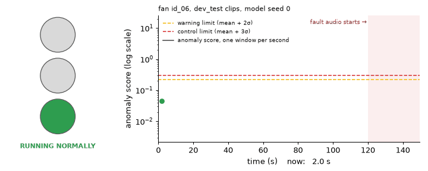

# Andon

Machine-sound anomaly detection. Andon learns what a healthy machine sounds like from normal recordings only, then raises a green / yellow / red andon signal when it starts to sound wrong. Stage 2 runs the same pipeline on a Raspberry Pi Pico 2 that cuts power to a real fan when it hears a fault.

> Work in progress. Results tables and the demo video are added as each phase is finished. See [PLAN.md](PLAN.md).



*Replay of one fan (machine `id_06`, development test clips, model seed 0, shown at 8x real time). About two minutes of normal running, then a fault. The yellow light partway through is a real warning that clears by itself without stopping the line. This machine was chosen to show how the light works; the typical rates are in the table below.*

## The andon light on streamed audio

A device hears one continuous stream, so the simulator plays test clips back to back and scores a 2 s window every 1.02 s. The light works like a control chart:

- **Limits.** For each machine, half of its normal test clips are scored to set a warning limit (mean + 2σ of the window scores) and a control limit (mean + 3σ). The other half is held back as the normal running the light is judged on.
- **Yellow** comes on after 2 windows in a row above the warning limit, and goes off after 3 windows in a row below it, so a score hovering at the limit doesn't make it flicker.
- **Red** needs 3 windows in a row above the control limit, and it stays on until someone resets it.
- **A fault** is 3 anomalous clips of the same machine played back to back (about 30 s), after 20 s of normal running.

The model is the Phase 3 machine-ID CNN (`phase3_idcnn_mixup`) used as is; nothing is retrained. Mean of the six machine types, mean ± std over model seeds 0, 1, 2, config `phase5_andon`:

| | Development test | Evaluation (scored once) |
| --- | --- | --- |
| False alarms per hour of normal audio | 4.49 ± 0.56 | 5.53 ± 1.79 |
| Faults caught before they end | 52.96 ± 0.99 % | 65.57 ± 1.02 % |
| Mean time from fault start to red, faults caught | 12.02 ± 0.32 s | 10.57 ± 0.24 s |

The machine types differ a lot. On the evaluation set, the light catches 94.27 ± 1.87 % of fan faults but 21.75 ± 2.22 % of valve faults, and its false alarms per hour range from 0.00 ± 0.00 (valve) to 14.38 ± 7.19 (pump). The per-type tables are in [results/phase5_simulator.md](results/phase5_simulator.md). Limits fitted on log scores were tried first and dropped. On dev they gave fewer false alarms (0.30 ± 0.30 per hour) but caught only 24.87 ± 0.72 % of faults, and almost none for ToyCar or valve (config `phase5_andon_log`; see DECISIONS.md). A few false stops an hour would be too many on a real line. The limits trade false stops against missed faults, and the Stage 2 work will pick that trade-off for one real machine.

```
uv run python -m andon.simulate --seed 0 1 2 --split dev_test
uv run python -m andon.simulate --summary --split dev_test eval --out results/phase5_simulator.md --config configs/phase5_andon.yaml configs/phase5_andon_log.yaml configs/phase5_andon_1clip.yaml
uv sync --all-groups                                   # adds the dashboard packages
uv run --group dashboard streamlit run dashboard/app.py  # live dashboard
uv run --group dashboard python -m andon.demo --gif docs/andon_demo.gif
```

The dashboard and the simulator need the downloaded data and the Phase 3 checkpoints.

## Quick start

Requires [uv](https://docs.astral.sh/uv/).

```
uv sync
uv run pytest -q
uv run python -m andon.data.download fan ToyConveyor
```

The download fetches the DCASE 2020 Task 2 development data for two machine types (about 3.3 GB) into `data/`, checks it, and prints the number of clips per machine ID. Use `all` to fetch all six machine types (8.1 GB).

## Data

DCASE 2020 Task 2 data, built from ToyADMOS and MIMII, licensed CC BY-NC-SA 4.0: the development dataset (https://zenodo.org/records/3678171), the additional training dataset (https://zenodo.org/records/3727685) and the evaluation dataset (https://zenodo.org/records/3841772), with the evaluation ground truth (https://zenodo.org/records/3951620).

## Licence

Code: MIT. Data: see above.
