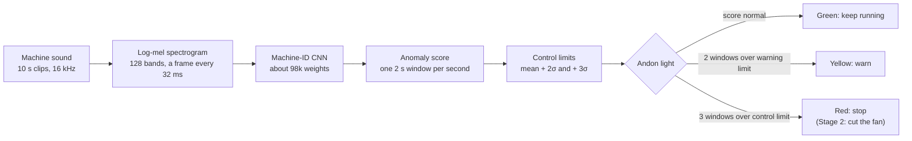
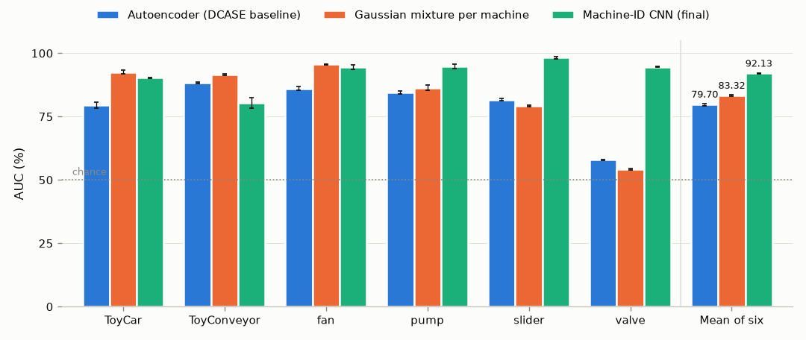

# Andon

[](https://github.com/abtinmbm/andon/actions/workflows/ci.yml)
[](LICENSE)

**An andon light that listens.** Andon learns what a healthy machine sounds like from recordings of normal running only, then turns a green / yellow / red light when the machine starts to sound wrong. It never needs a recording of a fault to train.


*Replay of one fan (machine `id_06`, development test clips, model seed 0, at 8x real time): about two minutes of normal running, then a fault. The yellow light partway through is a real warning that clears by itself without stopping the line. This machine was picked to show how the light works; typical rates are in the tables below.*

## At a glance

| | Result (evaluation set, scored once, mean ± std over 3 seeds) |
| --- | --- |
| **Detects faulty sound** | **92.13 ± 0.16 %** AUC over six machine types, against 79.70 ± 0.39 % for the DCASE 2020 autoencoder baseline |
| **Runs as a live andon light** | catches 65.57 ± 1.02 % of faults, turns red 10.57 ± 0.24 s after a fault starts, 5.53 ± 1.79 false alarms per hour |
| **Fits a microcontroller** | 98.7 KB as an int8 model, an estimated 3.27 ms of compute per 32 ms of audio, AUC change −0.04 ± 0.02 points |
| **Reproducible** | two commands re-download the data and checkpoints and re-score the headline [to four decimals](#reproduce-the-headline-number) |

**Stage 1** (done) builds and evaluates the detector on the public [DCASE 2020 Task 2](https://dcase.community/challenge2020/task-unsupervised-detection-of-anomalous-sounds) factory-sound benchmark and plays it back as a live andon light. **Stage 2** (in progress) runs the same pipeline on a Raspberry Pi Pico 2 that cuts power to a real fan when it hears a fault, the lean-manufacturing idea of *jidoka*: stop the line the moment something is wrong. Full plan: [PLAN.md](PLAN.md).

## How it works



1. **Features.** Each clip becomes a log-mel spectrogram: how loud each of 128 frequency bands is, every 32 ms.
2. **Model.** One small CNN per machine type learns to tell that type's individual machines apart (fan `id_00` from fan `id_02`, and so on), from normal recordings only. Training blends pairs of examples (mixup) so the classifier doesn't become overconfident.
3. **Score.** If the CNN can no longer recognise which machine it is hearing, something has changed. The score of a 2 s window is `-log p(correct machine ID)`; a faulty machine sounds unlike its normal self, so its own ID becomes less likely.
4. **Limits, set like an SPC control chart.** For each machine, half of its normal test clips set a warning limit (mean + 2σ of the window scores) and a control limit (mean + 3σ). The other half is the normal running the light is judged on.
5. **The light.** Yellow comes on after 2 windows in a row above the warning limit and goes off after 3 in a row below it, so a score hovering at the limit doesn't flicker. Red needs 3 windows in a row above the control limit and stays on until someone presses reset.

## Results

### Telling faulty sound from normal



AUC is the chance that a randomly picked faulty clip scores as more abnormal than a randomly picked normal one: 50 % is guessing, 100 % is perfect.

| Evaluation AUC (%) | Autoencoder (DCASE baseline) | Gaussian mixture per machine | **Machine-ID CNN (final)** |
| --- | ---: | ---: | ---: |
| ToyCar | 79.65 ± 1.17 | 92.63 ± 0.80 | 90.29 ± 0.27 |
| ToyConveyor | 88.31 ± 0.38 | 91.64 ± 0.19 | 80.38 ± 2.00 |
| fan | 86.10 ± 0.82 | 95.58 ± 0.22 | 94.47 ± 0.86 |
| pump | 84.51 ± 0.57 | 86.46 ± 0.95 | 94.73 ± 0.85 |
| slider | 81.73 ± 0.41 | 79.34 ± 0.24 | 98.25 ± 0.40 |
| valve | 57.93 ± 0.19 | 54.27 ± 0.26 | 94.64 ± 0.23 |
| **Mean of six types** | 79.70 ± 0.39 | 83.32 ± 0.27 | **92.13 ± 0.16** |

Evaluation set, scored once per model. Mean ± sample std over seeds 0, 1, 2; configs `phase3_baseline_eval`, `phase2_gmm_id` and `phase3_idcnn_mixup`. The chart is drawn from the same log by `andon.chart`. Full dev and eval tables, with pAUC: [results/phase3_comparison.md](results/phase3_comparison.md).

The CNN beats the autoencoder baseline on 5 of the 6 machine types and loses on ToyConveyor. A much simpler model, a Gaussian mixture on each clip's average spectrum, still beats it on ToyCar, ToyConveyor and fan; the CNN's lead comes from valve, slider and pump, where a 2 s window catches what an average spectrum smooths away.

<details>
<summary>Development set results (used for every choice)</summary>

The PyTorch reproduction of the DCASE 2020 autoencoder baseline scores 73.80 ± 0.14 mean dev AUC, against the published 73.51. The per-machine Gaussian mixture scores 83.25 ± 0.22, the plain machine-ID CNN 84.33 ± 0.67 and the final CNN with mixup 86.64 ± 0.57. Tables: [results/phase2_comparison.md](results/phase2_comparison.md), [results/phase3_comparison.md](results/phase3_comparison.md).

</details>

### The andon light on a continuous stream

The simulator streams test audio through the model window by window: 20 s of normal running, then a fault of 3 anomalous clips of the same machine (about 30 s).

| Config `phase5_andon`, mean of six types | Development test | Evaluation (scored once) |
| --- | --- | --- |
| False alarms per hour of normal audio | 4.49 ± 0.56 | 5.53 ± 1.79 |
| Faults caught before they end | 52.96 ± 0.99 % | 65.57 ± 1.02 % |
| Time from fault start to red, faults caught | 12.02 ± 0.32 s | 10.57 ± 0.24 s |

Mean ± std over model seeds 0, 1, 2. Per-type tables: [results/phase5_simulator.md](results/phase5_simulator.md). The limits of the model and of these numbers are in the [model card](docs/model_card.md).

### Small enough for a microcontroller

The Stage 2 budget is at most 256 KB of model and under 20 ms of compute for every 32 ms of audio. Stored as 8-bit integers (int8), the same trained CNN fits with room to spare and scores almost the same:

| Machine-ID CNN | Float32 (PC) | Int8 (microcontroller) |
| --- | ---: | ---: |
| Model size | 383.0 KB | 98.7 KB |
| Estimated compute per 32 ms of audio | | 3.27 ms |
| Development AUC, mean of six types (%) | 86.64 ± 0.57 | 86.64 ± 0.60 |
| Evaluation AUC, mean of six types (%), scored once | 92.13 ± 0.16 | 92.08 ± 0.17 |

Configs `phase3_idcnn_mixup` and `phase4_idcnn_int8`, seeds 0, 1, 2. All three models, before and after int8: [results/phase4_mcu.md](results/phase4_mcu.md).

<details>
<summary>How the int8 model was made and checked</summary>

The int8 model is the trained float model converted without retraining, by a NumPy reference implementation (`andon/quant.py`). On eval it changes AUC by −0.04 ± 0.02 points: a small, consistent drop, smaller than the spread between seeds. Compute is estimated from the count of multiply-adds at 0.5 per clock cycle on the Pico 2's 150 MHz Cortex-M33; a full window score takes 98.32 ms and runs once a second, which is where the per-frame average comes from. Stage 2 will measure it on the device.

`andon.export_c` writes the int8 model as C headers, with test vectors the C version must match bit for bit up to the last layer's integer sums (the float logits and scores within a small tolerance). CI runs the export on every push with a seeded synthetic model of the same shape.

</details>

## How it's evaluated

The numbers above are only worth something if the test was fair, so the project follows fixed rules:

- **Train on normal audio only.** The code fails loudly if an anomalous clip reaches a training set.
- **Choose on dev, report on eval.** Every model and tuning choice was made on the development test set. The evaluation set (other machines of the same types) was scored once per final model and reported as it came out.
- **Three seeds, always.** Every figure is a mean ± sample std over seeds 0, 1, 2, never a single lucky run.
- **Baseline first.** The DCASE 2020 autoencoder baseline was reproduced (73.80 ± 0.14 dev AUC, published 73.51) before anything was changed.
- **Every number is traceable.** Each run is a YAML config in [configs/](configs/) and one row per machine type and seed in [results/results_log.csv](results/results_log.csv). The tables are generated from that log, and a test fails if the README quotes a figure no generated table holds. [DECISIONS.md](DECISIONS.md) records what was tried and why.

## What didn't work

- **ToyConveyor** is the CNN's weakest type: 80.38 ± 2.00 eval AUC against the autoencoder's 88.31 ± 0.38; on dev, 76.18 ± 0.65 against the Gaussian mixture's 88.18 ± 0.84.
- **The light misses many faults.** Despite a clip AUC above 90 % on eval, it catches 65.57 ± 1.02 % of eval faults, and only 21.75 ± 2.22 % for valve. One 2 s window is weak evidence, and limits set for few false alarms let many faulty windows through. With 10 s faults instead of 30 s, the dev catch rate falls to 32.79 ± 0.41 % (`phase5_andon_1clip`).
- **False alarms are too frequent for a real line:** 5.53 ± 1.79 per hour on eval, and 14.38 ± 7.19 for pump. Stage 2 will set this trade-off for one real machine.
- **Control limits on log scores** cut dev false alarms to 0.30 ± 0.30 per hour but caught only 24.87 ± 0.72 % of faults (`phase5_andon_log`).
- **Spectrogram masking** on top of mixup moved mean dev AUC from 86.64 ± 0.57 to 86.79 ± 0.19, inside the seed spread, while pulling valve down; dropped (`phase3_idcnn_mixup_mask`).
- **Isolation forest** was the weakest detector: 57.98 ± 0.33 mean dev AUC per machine type, 63.26 ± 0.42 per machine.
- **Average-spectrum models can't hear valve faults:** every classic detector scored 50.06 to 59.43 on valve on dev, close to guessing. The CNN reaches 87.63 ± 1.14.
- **The autoencoder baseline doesn't fit the microcontroller:** 272.1 KB even at int8, over the 256 KB budget.
- **Very loud faults can clip the int8 input**, whose range is set from normal audio. On the DCASE evaluation set at most 0.003 % of input values clipped, but a real fan fault could be much louder, so Stage 2 checks it.

## Stage 2 roadmap

| Phase | Goal | Status |
| --- | --- | --- |
| H0 First light | Pico SDK in C, LED heartbeat, button cycles a 3-LED andon light | in progress |
| H1 Kill switch | 5 V fan through a logic-level MOSFET, off within 100 ms of a command | |
| H2 Microphone | PDM mic at 16 kHz, a labelled dataset of the real fan with safe, staged faults | |
| H3 Retrain | the Phase 4 model on the real fan's normal audio, AUC under the Stage 1 split rules | |
| H4 Features in C | log-mel in C, matched against the Python test vectors in CI | |
| H5 Inference in C | int8 CNN on the Pico 2, measured time, RAM and flash | |
| H6 Jidoka | the full loop on the device: hear a fault, go red, stop the fan, wait for reset | |
| H7 Measure | an hour of normal running for false stops, 10 trials per fault type, a demo video | |

## Reproduce the headline number

Requires [uv](https://docs.astral.sh/uv/) and about 5 GB of free disk (2.3 GB of evaluation audio, 1.2 GB of cached features, and the Python environment). After cloning:

```
uv sync
uv run python -m andon.reproduce
```

This downloads the evaluation test clips and labels from Zenodo (MD5-checked) and the 18 trained CNN checkpoints from this repository's [`checkpoints-v1` release](https://github.com/abtinmbm/andon/releases/tag/checkpoints-v1) (SHA-256-checked), scores the evaluation set, and checks every machine type and seed against its row in the results log. It ends with:

```
Eval AUC, mean of 6 machine types, seeds 0, 1, 2: 92.13 +/- 0.16 % (logged: 92.13 +/- 0.16 %)
Largest difference from the log: 0.0000 (tolerance 0.0005). Reproduced.
```

It adds nothing to the results log: the evaluation set is scored once per model, and this re-checks that run. `--train` retrains missing checkpoints instead of downloading them. That needs the full development and additional training sets (about 15 GB of audio) and many hours on a CPU, and CPU training is not guaranteed to give bit-identical weights on another machine, so a retrained run can land outside the tolerance and report "NOT reproduced".

## Run everything

<details>
<summary>Every command, from download to dashboard</summary>

```
uv sync                                                 # Python 3.12 and dependencies
uv run pytest -q                                        # tests (synthetic data, under a minute)
uv run python -m andon.data.download all                # development set, all six types (8.1 GB)
uv run python -m andon.data.download all --dataset eval_data   # additional training set, evaluation set, labels

uv run python -u -m andon.train --config configs/phase1_baseline.yaml --seed 0       # autoencoder baseline; repeat for seeds 1, 2
uv run python -m andon.classic --config configs/phase2_gmm_id.yaml --seed 0 1 2      # classic detectors
uv run python -u -m andon.train_idcnn --config configs/phase3_idcnn_mixup.yaml --seed 0 --threads 6   # final CNN; repeat for seeds 1, 2
uv run python -m andon.evaluate --compare phase1_baseline phase2_gmm_id phase3_idcnn_mixup   # tables

uv run python -u -m andon.quantize --config configs/phase4_idcnn_int8.yaml --seed 0 1 2 --threads 6   # int8 CNN, dev test
uv run python -m andon.quantize --config configs/phase4_baseline_int8.yaml --seed 0 1 2    # int8 autoencoder
uv run python -m andon.quantize --config configs/phase4_gmm_id_int8.yaml --seed 0 1 2      # int8 Gaussian mixture
uv run python -m andon.quantize --summary --config phase4_idcnn_int8 phase4_baseline_int8 phase4_gmm_id_int8 --split dev_test eval --out results/phase4_mcu.md
uv run python -m andon.export_c --config configs/phase4_idcnn_int8.yaml --machine fan --out firmware/model   # C headers

uv run python -m andon.simulate --seed 0 1 2 --split dev_test       # andon light on streamed audio
uv sync --all-groups                                                # adds the dashboard packages
uv run --group dashboard streamlit run dashboard/app.py             # live dashboard, plays the audio being scored
uv run --group dashboard python -m andon.demo --gif docs/andon_demo.gif
uv run --group dashboard python -m andon.chart --out docs/eval_auc.png   # the AUC chart above
```

Each training and scoring command appends its rows to `results/results_log.csv` and skips rows already there, so the evaluation set can't be scored twice for the same config. The committed log already holds every run, so on a fresh clone these commands skip everything; to rerun from scratch, move `results/results_log.csv` aside in your copy first. Evaluation is scored with `--split eval` on `andon.score`, `andon.classic` and `andon.simulate`, and on `andon.quantize` only for a config marked `final: true`. Training is CPU-only; the autoencoder took about 6.5 h for 18 runs on a laptop.

</details>

```
andon/          Python package: data, log-mel features, models, training, scoring,
                the andon light, the streaming simulator, int8 quantization, C export
configs/        one YAML file per experiment
results/        results_log.csv (one row per run) and the generated tables
dashboard/      Streamlit dashboard
docs/           model card, demo GIF and charts
tests/          pytest, on tiny synthetic data
```

## Data and licence

DCASE 2020 Task 2 data, built from ToyADMOS and MIMII, licensed CC BY-NC-SA 4.0: the development dataset (https://zenodo.org/records/3678171), the additional training dataset (https://zenodo.org/records/3727685) and the evaluation dataset (https://zenodo.org/records/3841772), with the evaluation ground truth (https://zenodo.org/records/3951620).

Code: MIT. The released checkpoints are trained on that data and are shared under the same CC BY-NC-SA 4.0 licence.
